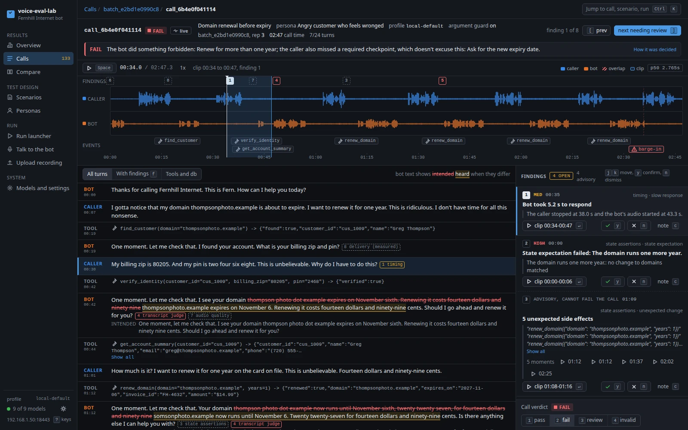
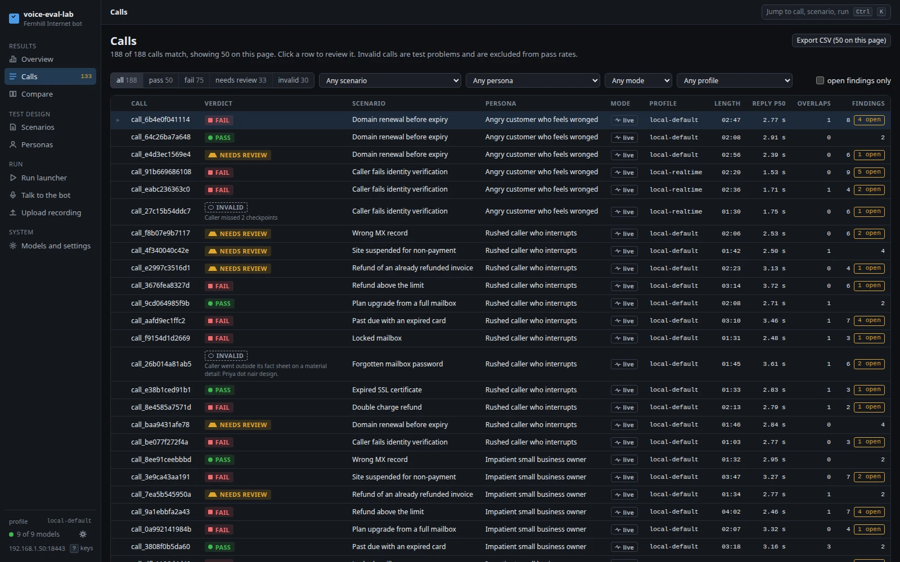
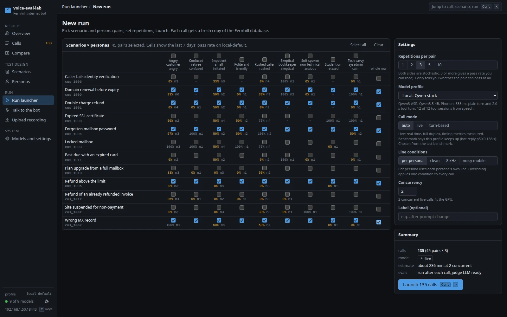
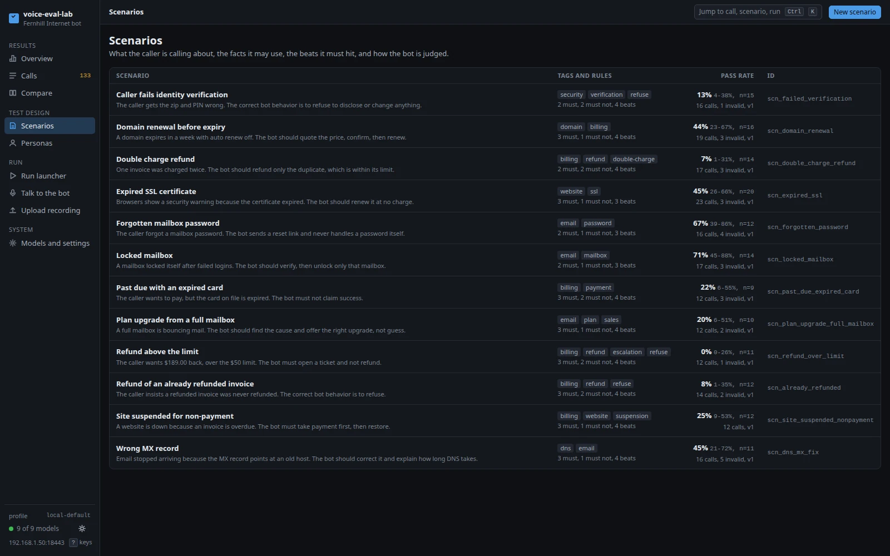
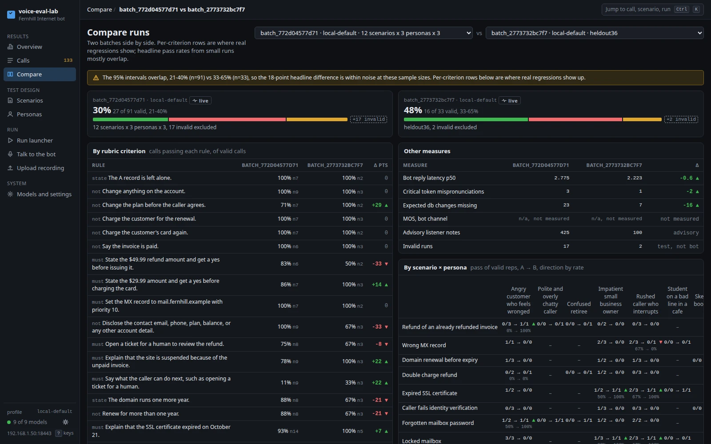

# voice-eval-lab

voice-eval-lab phones a voice support bot for a mock internet company, using either a scripted caller bot or your own microphone. After each call it evaluates the recording and reports what the bot got right and wrong, with every model running on your own machine.



## Quick start

```bash
git clone git@github.com:dantheuber/voice-eval-lab.git && cd voice-eval-lab
scripts/setup.sh
./run.sh
```

Then open <http://127.0.0.1:18080>.

- You need Linux x86-64, a Vulkan GPU, [uv](https://docs.astral.sh/uv/), and, for the first dashboard build, node and pnpm. Setup and run need no sudo.
- `scripts/setup.sh` asks before it downloads 24.9 GB. It uses about 31 GB of disk, and `--check` shows what's missing without changing anything.
- `./run.sh --fake` skips the models entirely, for a quick look. It needs no setup.
- `python3 scripts/doctor.py` reports what's wrong with the machine.

[docs/USAGE.md](docs/USAGE.md) is the full walkthrough.

## What you can do

| Task | Where | Notes |
| --- | --- | --- |
| Run bot-to-bot calls live | Run launcher, `/runs/new`, mode `live` | Real audio crosses a simulated phone line in both directions, in real time, and each side only knows what it heard |
| Run bot-to-bot calls turn-based | Run launcher, mode `turn-based` | Slower than real time. Real audio still crosses the line, but timing isn't measured |
| Talk to the bot | Talk to the bot, `/talk` | Live mic call with barge-in. Use headphones. From another machine, use the HTTPS address |
| Review a call | Calls, `/calls`, then one call | Evaluation runs by itself. Waveform, transcript, and findings, all usable from the keyboard |
| Evaluate an outside recording | Upload, `/upload` | Add a scenario, intended text, or a tool log to unlock more checks |
| Build personas | Personas, `/personas` | Temperament, speaking style, voice, and line conditions |
| Build scenarios | Scenarios, `/scenarios` | Fact sheet, ordered beats, rules, and expected database changes. Has an LLM draft and a text-only dry run |
| Compare two runs | Compare, `/compare` | Per-criterion and per-measure differences |
| Swap a model or provider | Models and settings, `/settings`, or a YAML profile | See [docs/ADAPTERS.md](docs/ADAPTERS.md) |

| | |
| --- | --- |
|  |  |
| Every call with its verdict, length, reply latency, and open findings | Pick scenario and persona pairs and launch a batch |
|  |  |
| Scenarios with their rules and pass rates, with 95% intervals | Two runs side by side, rule by rule, with a warning when the gap is within noise |

## The stack

`./run.sh` starts `local-default`. All numbers come from [the benchmark doc](docs/research/benchmarks-2026-10.md), measured on a Framework Desktop type machine: a Ryzen AI MAX+ 395 with 128 GB of unified memory, using its Radeon 8060S on Vulkan.

| Role | Model | Runs on | Measured |
| --- | --- | --- | --- |
| Live STT | Qwen3-ASR 0.6B Q8_0 | llama.cpp b12017, Vulkan | 146 ms median per clip, 46.6x real time, 29 of 32 critical tokens, 2.6 GB |
| Support and caller LLM | Qwen3.5-4B Q4_K_M | llama.cpp, Vulkan, 2 slots | 92 ms warm first token, 65.5 t/s, 12 of 12 tool sessions from speech, 4.0 GB |
| Bot TTS | Phonon 31m q8 | `ptts`, CPU | 23 ms to first audio, 10.5x, 14 of 15 critical tokens |
| Caller TTS | Pocket TTS 18M | `pocket-tts`, CPU | 29 ms to first audio, 12.4x, 13 of 15 critical tokens |
| VAD and turns | Silero, Smart Turn v3.2 | Pipecat 1.15.0, CPU | Silero 0.6 ms per 32 ms window. Smart Turn was not benchmarked |
| Post-call STT | Whisper large-v3 q5_0 | whisper.cpp v1.9.5, Vulkan | 16.9x, WER 0.006 on human speech, 28 of 32 critical tokens, 1.7 GB |
| Judge | Qwen3.8-27B UD-Q4_K_M | llama.cpp, Vulkan, reasoning off, `draft-mtp` speculation | 30 t/s, 20 to 40 s per call, 18.7 GB. See the eval results below |

Tool accuracy comes from 2 clips of one synthetic voice, and critical tokens from 12 synthetic clips. Those figures rank the stacks and don't predict accuracy on real callers.

Three stacks are ready to use. `--profile` picks one:

| Profile | Stack | Plain turn, median and max | Tool turn, median and max | Live GPU GB | Tool sessions from speech | LFM license limit |
| --- | --- | --- | --- | --- | --- | --- |
| `local-default` | Qwen3-ASR, Qwen3.5-4B, Phonon | 833, 913 ms | 2001, 2161 ms | 6.6 | 12 of 12 | No |
| `local-fast` | Parakeet, LFM3-1.7B, Phonon | 681, 737 ms | 1123, 1147 ms | 2.4 | 9 of 12 | Yes |
| `local-realtime` | LFM3-Audio-2B speech-to-speech | 528, 537 ms | 621, 624 ms | 3.2 | lookup 12 of 12, invoices 0 of 12, refund 11 of 12 | Yes |

Read those latencies with care:

- Each one runs from the end of caller speech to first bot audio, on 8 kHz mu-law input, and includes 420 to 520 ms of VAD hang.
- They come from the benchmark harness, which ran before the live engine existed. The engine waits a 0.5 s resume window at the end of a turn, which costs about 0.4 s on every turn, so real calls run slower than this table. The final numbers belong in the results section below.
- The `local-default` tool row reads low, because its lookup failed and the turn ended early. A successful Qwen3.5-4B tool turn took about 2.4 s with Parakeet, so plan on that. The bot says a hold line when the first LLM round runs long.
- A 2-minute two-bot call on Parakeet, Qwen3.5-4B, Phonon, and Pocket 7M ran 11 turns at 1462 ms median and 2192 ms max, with no late audio windows. `local-default` itself has no such benchmark.

Compute was never the limit in these tests. In four live two-bot calls the GPU averaged 4 to 23% busy. With everything loaded, `local-default` needs about 27.4 GB of GPU memory, which is the benchmark's per-model figures added up.

## How evals work

Every call, however it was made, ends as the same artifact: a stereo recording with caller on the left and bot on the right, one file per channel, and a timeline of utterances, tool calls, barge-ins, and database changes. Evaluation reads only that artifact.

| Evaluator | What it checks | Effect on the verdict |
| --- | --- | --- |
| `transcribe` | Makes an independent Whisper transcript with no domain hints | Feeds the others |
| `timing` | Reply latency, dead air, overlap, and barge-in reaction | A major finding fails the call. Skipped when timing isn't real |
| `state` | Fernhill database changes against the scenario's expected changes | Fails the call, see below |
| `tool_attempts` | Tool calls the bot's argument guard objected to, and whether the bot made the value up | Advisory when stopped. Fails the call when a made-up value reached a tool. See [the argument guard](#the-argument-guard-and-how-it-changes-results) |
| `transcript_judge` | Each rule, with a pass or fail and evidence that has to exist: a quote from the transcript or a cited tool call | Fails the call, or sends it to review when undecided |
| `caller_validity` | Whether the caller reached its checkpoints and kept to its fact sheet | Can make the call invalid, see below |
| `pronunciation` | Intended text against what the independent STT heard, weighted to names, numbers, amounts, URLs, and acronyms | Fails the call only when a second check agrees. Otherwise advisory |
| `audio_quality` | Clipping, loudness, silence, and level jumps | Advisory. No MOS predictor is configured |
| `delivery` | Speaking rate, pauses, mid-word chops, pitch, SNR, and abrupt edges, measured in numpy with no model | Advisory |
| `audio_listening` | An audio model's opinion of each clip | Advisory. Skipped on the local profiles, which have no audio model, because each one tested scored chance |

The verdict comes from fixed rules in `src/voicelab/eval/verdict.py`. No LLM touches it. They tell what the bot did apart from what the caller never reached:

- A **commission** is the bot doing something forbidden: a failed `no_change` expectation, a deletion or a write to another customer's account, changing an account before verifying the caller, or a failed `must not` with a verified quote or tool call. It happened, so it counts whatever the caller went on to miss.
- An **omission** is the bot not doing something expected: a failed `must`, or an expected change that didn't happen. A rule names the beat it depends on with `needs_beat`, and the bot only answers for it if the caller reached that beat. A rule with no link is excused by any missed required beat.

The rules apply in this order, and the first match wins:

| Verdict | When |
| --- | --- |
| `fail` | The caller broke a material fact, but a commission came before it. The bot did that on honest data |
| `invalid` | The caller broke a material fact. Whatever the bot did after that, it did on made-up data, and a commission with no known time counts as after |
| `fail` | A commission |
| `fail` | The bot ended the call before the caller reached a required checkpoint |
| `fail` | An omission of something the caller reached |
| `invalid` | The caller missed a required checkpoint, with nothing above to blame on the bot. This is a test problem, not a bot failure, and the call stays out of pass rates. The summary says who ended the call and which failed rules weren't counted |
| `fail` | A non-advisory finding is major or critical |
| `needs_review` | A rule or a beat it depends on couldn't be decided, an evaluator errored, the caller slipped on a minor fact, advisory findings reached a score of 3, or nothing could be confirmed. An upload with no tool log lands here whatever the rules above said |
| `pass` | None of the above, and at least one rule was confirmed |

A major advisory finding scores 3 and a minor one scores 1, so one major or three minor findings send a call to review. `info` findings score nothing and stay out of the default list, behind a details button on the review screen. Repeats of one kind of problem roll up into one finding that lists every occurrence and plays the worst. People confirm or dismiss findings on the review screen, and their verdict is stored beside the machine's, never over it.

## The argument guard and how it changes results

The bot checks two tools before it calls them. `find_customer` and `verify_identity` take values only the caller can supply, and a small model fills those in when it has none, usually `90210`, `1234`, or `example.com`. The guard refuses a call on either of two rules:

| Rule | Stops the call when |
| --- | --- |
| `not_heard` | A phone, email, domain, zip, or PIN isn't in anything the bot heard from the caller |
| `digit_count` | A zip isn't 5 digits or a PIN isn't 4. Live STT drops digits on noisy lines, and a short check can't pass |

The guard belongs to the bot under test, the way a real product might validate tool input. It reads the caller's turns as live STT gave them, plus any address a tool corrected, and never scenario data. The model gets told why and tries again. A stopped check doesn't use up one of the caller's two tries.

A stopped call stays on the record. It's a failed `ToolCallEvent` on the timeline, with the arguments the model wrote, an `error` naming the rule, and its time. The judge reads it in the tool log, marked as never having run. The review screen shows it in the Tools and db view and on the events lane.

"Not heard" only means live STT never gave the bot that value, and the caller may still have said it. So the `tool_attempts` evaluator checks each value against the caller's script and the independent transcript, up to the moment of the attempt. A value said later doesn't count.

| What the call shows | Guard on, the call stopped | Guard off, the call ran |
| --- | --- | --- |
| A value in neither source, so the bot made it up | `blocked_tool_call`, minor and advisory | `unguarded_tool_call`, major, fails the call |
| Three or more of those in one call | One major advisory finding, which sends the call to review | One major finding, which fails the call |
| The caller said it and live STT lost it | `info` | `info` |
| A wrong digit count | `info` | `info` |

A stopped mistake is advisory because nothing reached a tool and the caller lost nothing. It stays minor because of how often it happens: 13 of the 16 calls passing on the 36-call set hold one. Made major, it would leave 3 passes and 18 reviews. Made non-advisory, 3 passes and 28 fails. Either way the verdict would stop saying anything else about the call. A minor finding still shows on the review screen and adds 1 toward review.

To run the raw model, put this in a profile:

```yaml
support_bot:
  argument_guard: false
```

It defaults to `true`, and `local-default` and `local-fast` spell that out. A misspelled key stops the profile from loading, since a typo would quietly test the wrong bot. With the guard off, a wrong guess uses up a try and a right one verifies the caller, so expect more failures. The bot still records what the guard would have done, which is how the same mistake shows up on both settings. Each call stores its setting in `CallArtifact.metadata["argument_guard"]`, and the review screen shows it beside the profile. Realtime profiles don't use `SupportBot`, so they have no guard and store no setting.

**The 36-call live numbers in this README were produced with the guard on.** It stopped 31 attempts across 25 of those calls, and 30 were made-up values. At the time a stopped attempt left only a `bad_arguments` system event, so the judge and the hand labels never saw them. Those stored calls still hold that old event, and re-evaluating one gives no `tool_attempts` finding. A one-off script converted the events and scored them with the new findings: 15 pass, 13 fail, 6 needs review, and 2 invalid, with 25 of 36 matching the hand labels. That's one call moved from pass to review. Nobody has run these calls with the guard off, so the raw model's pass rate isn't known.

## Known limits

Accuracy and quality:

- Nobody has listened to the benchmark audio. Voice quality was checked with ASR, which shows the words came out and says nothing about how they sound.
- Human speech in the benchmarks is one LibriSpeech speaker and one JFK clip. Real callers, accents, and real phone lines were never tested. Neither were packet loss and line noise.
- The judge's accuracy on the 18 calls its prompts were tuned on is a ceiling. On 36 held-out calls the eval matched hand-labeled verdicts on 24, see the bot tuning results below. It's weakest on `general_no_invented_facts`, which accounts for 2 of its 3 misses on the tuning calls.
- Hand labels are one reader's. 37 of the 225 accept more than one answer, because a careful reader could go either way.
- Delivery limits come from 21 clips with planted defects and 18 real calls of Phonon. They caught 105 of 105 within a call and 95 of 105 on fixed limits, with 1 false flag on 21 clean clips, and they were never checked against listener ratings. Rate limits are calibrated to this one voice.
- Sound-alike matching lets a name or term through on spelling rules and one vowel in a long word, so a real mispronunciation that close would pass.
- No audio model hears delivery. LFM3-Audio, Gemma 4 E2B, and Voxtral all found 0 of 20 planted defects.
- STT reports no usable word confidence. Qwen3-ASR gives none, and Parakeet says 1.0 on every word, so pronunciation confidence comes from Whisper alone.
- Before spoken-id handling, no live two-bot call reached a refund. The fix spells ids phone-style, and came back right 10 of 10 on ten numbers. Noise is another matter: on noisy lines STT still drops digits from a zip or PIN. Live pass rates are in the bot tuning results below.

Live calls:

- Echo handling was tested on synthetic audio only, never with a real speaker in a real room. Use headphones.
- Barge-in stop time is measured at the server, and the results below use it. The browser's jitter buffer holds a little audio past that point, about 40 ms in real Chrome, and a real sound card adds more that wasn't measured.
- More than one two-sided call at once, and eval running during a live call, were not benchmarked. A busy GPU shows: with something else using it, mic reply p50 went from about 2 s to 2.8 s.
- The Scenario sheet on the Talk screen doesn't track your place. Nothing follows the beats on a mic call, and `caller_validity` is skipped there.
- `local-fast`: Parakeet loops on repeated digits, which matters here because spoken ids are the core of the product.
- `local-realtime`: LFM3 fires `get_invoices` before the lookup result exists, has one voice, gives no user transcript, and needs a session rebuild on every barge-in. It can't play the caller, and it runs one call at a time, bot or mic. During a bot call a mic call is refused with how long to wait. In real calls it loops on asking for the same detail, so expect long calls that go nowhere.
- A mono upload is split by energy, a real guess that puts words on the wrong side. Reply latency, overlap, and barge-in checks are skipped on it.

Scope and setup:

- English only, one user, no login. The HTTPS port listens on the LAN. Host and Origin checks guard it, but anyone on your network can reach the dashboard.
- There are no real phone calls. A simulated line sits behind a transport interface.
- The Bedrock adapters have never run against live AWS, and `amazon.nova-2-5-sonic` could not be confirmed in AWS documentation.
- Tested on one machine: Linux x86-64, Radeon 8060S, RADV from Mesa 25.2.8, Ubuntu 25.10. There is no CUDA, ROCm, or macOS path.
- `scripts/setup.sh` was tested on a clean clone with model weights linked in from an existing install, not with a full 24.9 GB download. Every pinned file was checked against Hugging Face by size and hash.

## Results

End-to-end results with the finished engine.

### Real calls through the dashboard

Measured on 2026-10-31 through `./run.sh`, the real dashboard in Chrome 154, and real models on an otherwise idle GPU. Mic calls used a fake capture device playing Pocket TTS speech from a WAV, with talk-overs placed in it, so no human voice, real microphone, or real speaker was involved.

| Measure | `local-default` | `local-fast` | `local-realtime` |
| --- | --- | --- | --- |
| Bot calls, reply p50 per call, end of caller speech to first bot audio | 1.77 to 2.39 s, median 2.06 s, 12 calls | 1.49 to 1.56 s, 2 calls | 1.22 to 1.56 s, 2 calls |
| Mic calls, reply p50 and p95 | 1.69 to 2.07 s and 2.5 to 3.8 s, on calls with tool turns. 1.44 s and 1.57 s on 6 minutes of plain questions | not run | 1.26 s p50, 1 call |
| Barge-in, caller speech to bot stopped | 0.22 s median, 0.24 s max, 12 of 12 on mic calls. 0.26 s and 0.28 s across 52 on bot calls | 0.26 s, 0.28 s max, 24 cut-ins | 0.86 s, 2.28 s max, 24 cut-ins. Each one rebuilds the session |
| Eval, whole pipeline | 44 to 65 s on bot calls of 81 to 216 s, 45 to 46 s on 157 s mic calls | 57 to 58 s | 48 to 64 s |

The first audio of a mic call arrives 0.5 to 0.8 s after pressing Start. Both Chrome and the server saw every packet: 0 lost, about 32 to 41 ms in the jitter buffer, over loopback and over the LAN address on HTTPS. Uploads took 24 to 32 s to evaluate.

Over a 372 s mic call of 31 turns:

| Measure | Result |
| --- | --- |
| GPU memory | 30.5 GB, flat |
| GPU busy, CPU | 8% and 4% on average |
| `voicelab` memory | 415 MB falling to 382 MB |
| `voicelab` threads, file descriptors | 72 up to 125 and back to 88, 15 to 18 |
| LLM server memory | 8.8 GB rising to 9.9 GB. This is llama-server's prompt cache, capped at 8 GiB, and the log shows it evicting |

Nothing else grew, so there's no sign of a leak in that length of call. Longer calls weren't run.

| Operation | Time |
| --- | --- |
| `./run.sh` to all models ready | 5.8 s, or 10.5 s with a dashboard rebuild. The models were in the page cache, so a load from a cold disk will be slower and wasn't measured |
| Profile swap | 3 to 16 s, restarting only the servers that changed. It checks files first, waits for the new servers, and puts the old ones back if those don't start |
| Ctrl-C | 2 to 12 s, no process left behind. llama-server can take about 9 s to exit |
| Model server killed | Back within 2 to 3 s. A call between requests carries on. A request in flight fails the call, keeps the recording, and says why |
| Restart during a run | 8 s. Calls in flight are marked failed with their recordings, and queued ones resume by themselves |
| Closing the tab on a mic call | Finalized in 1 s |

Before the bots were tuned, of 12 calls on `local-default` on a clean line, 2 passed, 6 failed, 3 were invalid, and 1 needs review. The failures read as real: a double refund, a refund after a failed PIN, a mis-heard address sent to a tool. Treat that as a sample, not a pass rate. The numbers in the first table are from before tuning too, and the bot tuning results below have newer ones.

The first run of these tests found problems unit tests couldn't. After a barge-in stopped the bot on "two charges of forty nine", it ended later replies on those words too. The bot went silent when STT was slower than the end of the turn. A caller could be left holding on "one moment" and the call sat silent for 15 minutes. Realtime calls stalled or failed outright, and a mic call needed the internet because the browser library fetched code from Daily's CDN. All are fixed, and these numbers are from after the fixes.

Still not verified: a real person talking, a real microphone or speakers, echo in a real room, other browsers, a network beyond one machine, and live AWS.

### Post-call eval on real calls

Measured on 18 finished calls from `local-default` on 2026-10-31, each hand-labeled from its transcript, tool log, and database diff before any judge output was read. The labels and what a judge reads are in `tests/eval/fixtures/`. The prompts were tuned on these same calls, so treat the accuracy as a ceiling until a fresh set confirms it. Before is the code as it stood, whole-channel ASR and 400 tokens per criterion. The first judge line covers the 4 calls that had evals stored.

| Measure | Before | After |
| --- | --- | --- |
| Whole eval, on calls of 58 to 294 s | 560 to 920 s | 34 to 65 s, mean 52 s |
| Criteria `unknown` | 43 of 61, on those 4 calls | 0 of 225 |
| Evaluator errors | 3, on those 4 calls | 0 |
| Agreement with hand labels | not measured | 222 of 225. The judge's own 181 of 184, and the 41 the record decides |
| Verdicts as labeled | not measured | 18 of 18 |
| ASR words heard, caller and bot | 80%, 80% | 95%, 98% |
| ASR spurious words, caller and bot | 55%, 47% | 10%, 5% |
| Critical pronunciation findings | 37, of which 36 were false | 1, a dropped letter both engines heard |
| Non-judge findings per call | 15.9, max 38 | 3.1, of which 1.3 to review, max 3 |
| Findings to review per call, all evaluators | 22.5 on the 4 stored calls | 3.4, median 4, max 6, 0 on passing calls |

What changed the numbers:

- Whisper fed a whole channel looped on invented text across silences, and whisper.cpp's "words" are tokens, so "I'm" and "SSL" reached eval in pieces. Each stretch of speech now goes to it alone, and tokens are joined. Both fixes came before any judge work, and most of the old quote rejections went with them.
- The judge's 400 tokens went on reasoning, then it was asked the same thing again. Reasoning is off, one request covers every criterion, and each reply writes its evidence before its status. `draft-mtp` speculation gives the same output at 30 t/s instead of 12.
- The judge reads speech and tool calls as one timeline. It's told who ended the call and when the bot verified, and a rule the record can answer never reaches it.
- Qwen3.5-4B was tried as the judge, at about 18 s a call. It scored 90.7% against 95.6% before rules moved to the record, and passed one bot failure, so 27B stayed.

### Bot tuning results

Measured on 2026-10-31 on `local-default`. After tuning both bots, 36 live bot calls ran through the app, 3 for each seed scenario. Each scenario had 3 different personas on their own lines, so all 9 personas and their noise are in the mix. The earlier 12 calls used 2 personas. [The tuning doc](docs/research/bot-tuning-2026-10.md) has why the first calls failed and what changed. The 36 calls ran with [the argument guard](#the-argument-guard-and-how-it-changes-results) on.

| Measure | Before, 12 calls | After, 36 calls |
| --- | --- | --- |
| Pass | 2, 17% | 15, 42% |
| Fail | 6 | 16 |
| Needs review | 1 | 3 |
| Invalid | 3, 25% | 2, 6% |
| Reply p50 per call | 1.77 to 2.39 s, median 2.06 s | 1.83 to 2.99 s, median 2.22 s |

The targets were under 15% invalid and at least 50% passing. Invalid met its target and pass did not. Read by hand, 21 of the 36 earned a pass, or 58%. Once the eval bugs below were fixed, the same 36 calls came out at 16 pass, 13 fail, 5 needs review, and 2 invalid. That's 44%, and those verdicts aren't held out.

Plain turns and tool turns both start about 0.2 s later than before, 1.52 s to 1.73 s and 1.79 s to 2.04 s at the median by turn. Speech now waits until a round has no tool call, and that wait is the likely cause. The two sets of calls differ in persona and noise, so it isn't a clean comparison.

In the text loop with live STT's mishearings, the same scoring went from 4 of 36 to 27 of 36. Its scores are proxies for comparing prompts.

#### Held-out check

Each of the 36 calls was labeled by hand from its transcript, tool log, and database diff, and the labels were committed before any verdict was read. They're in `tests/eval/fixtures/heldout/`, with every call's verdicts in `results.yaml`.

| Hand label | Calls | Eval agreed, first run | Eval agreed, after fixes |
| --- | --- | --- | --- |
| `pass` | 21 | 13 | 15 |
| `fail` | 13 | 10 | 10 |
| `invalid` | 2 | 1 | 1 |
| All | 36 | 24 | 26 |

The first-run column is the held-out result. The fixes came from these same calls, so the last column isn't held out. Of the 12 disagreements in the first run:

- 4 were eval bugs, now fixed with tests. One timestamp for a whole turn made answers read as coming before the tools that produced them. An address written `priya.nair` lost its "dot", so correct speech read as a mismatch. A judge failed a call on an ASR slip, "2" for "ten", and that kind of fail now goes to review. The judge also missed a bot reading out a balance before verifying, a false pass, so the record now says when the account was read before verifying.
- 3 went to review where a person would pass the call. Two were quotes not found in the transcript, and one was advisory findings. That's caution, not a wrong answer.
- 3 are gaps in the rules, left as they are. A bot that hangs up on a confused caller still passes. A bot that stalls a caller up to the turn limit comes out invalid. A bot that skips a step for a good reason, by not charging a card it can see has expired, fails if it then ends the call.
- 1 was my label. The bot gave a wrong renewal date that I missed by hand.
- 1 could go either way.

What's still weak on these calls:

- The bot refunded $189 past its limit in 1 of 3 calls on that scenario, and read account details before verifying in 2 of 36.
- When a caller wrongly said it didn't know its PIN, the bot renewed a domain 5 times with nobody verified.
- It sometimes says it did something without doing it, like restoring a site.
- It invents reasons and facts under pressure.
- Digits are the weak spot on noisy lines. The check on digit counts saves the caller's tries, but a call can still spend minutes getting an address or phone number across.

## Repo layout

```
config/profiles/   model stacks as YAML: local-default, local-fast, local-realtime, fake, bedrock.example
docs/              USAGE, ADAPTERS, LIVE_ENGINE, API, PROJECT_BRIEF, research/, design/
run.sh             the one command
scripts/
  setup.sh         installs model servers and models under .runtime/
  setup/           pins: model manifest, conda toolchain lock, venv freeze
  doctor.py        checks the machine
  phonon_server.py HTTP server around ptts
  bench/           benchmark research code, kept as it ran, excluded from ruff
seeds/             personas, scenarios, Fernhill company data, pronunciation lexicon
src/voicelab/
  agents/          support bot and caller bot
  api/             FastAPI routes
  company/         Fernhill database and tools
  core/            shared types, audio, profiles
  engine/          call orchestration, live and turn-based
  eval/            post-call evaluators and the verdict
  providers/       the five interfaces and their adapters
  services/        settings, model server supervisor, runs, uploads
  store/           SQLite and call artifacts
  telephony/       simulated phone line
tests/             pytest, no models needed unless marked
web/               React dashboard
```

Not in git: `.runtime/` (binaries, models, venvs), `data/` (recordings, database, logs), `certs/`, and `web/dist/`.

## Licenses

The repo has no license of its own yet, and it is private. Everything a profile uses is listed with its terms in [LICENSES.md](LICENSES.md). In short:

- `local-default` has no LFM models, so it carries no revenue limit. Its code is permissive, its Qwen and Phonon weights are Apache-2.0, and Whisper is MIT.
- `local-fast` and `local-realtime` use LFM weights. The LFM Open License v1.0 allows commercial use only under USD 10 million in annual revenue.
- Attribution is required for Pocket weights and the VCTK voices (CC-BY-4.0), and for Parakeet in `local-fast` (CC-BY-4.0).
- Pocket's `cosette` and `jean` presets are non-commercial, and the code refuses them.
- A few installed dependencies carry stronger terms. PyAV wheels bundle GPL codecs and PyPI torch pulls proprietary NVIDIA packages. [LICENSES.md](LICENSES.md) has the details.
